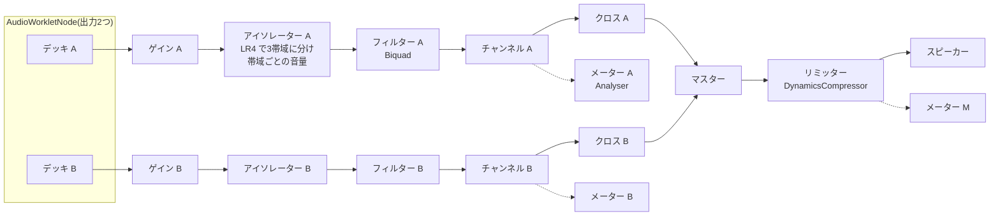

# DJターンテーブル Pro(2台+ミキサー) 設計書

2026-11-07 作成(外部設計・プログラム設計)。同日に1期を実装。1台の通常版(`tools/dj-turntable`)はそのまま残し、高機能版を別のツールにする

## 1. 概要

目標は「Web アプリとは思えない、実物のような手触りと高級感」です。レコードのターンテーブル2台と2チャンネルのミキサーを、スマホとパソコンのブラウザで動かします。

- 手本にする実機: Technics SL-1200MK7(ダイレクトドライブ)×2台と、スクラッチ向けの2チャンネルミキサー(Rane のような形)。
- 手本にするアプリ: Serato DJ / rekordbox / djay。ここからは波形・キュー・BPM のような「画面ならではの便利さ」を取り入れます。
- 見た目と手触りは実機に寄せ、ソフトでしかできないこと(波形・BPM・ホットキュー)は控えめに添えます。

通常版の `tools/dj-turntable`(1台・軽い)はそのまま残し、このツールは `tools/dj-turntable-pro-pro` として別に作ります(逆回転やスクラッチの知見は [lessons.md](../lessons.md) の「音」)。

## 2. 調べたこと

### 2.1 実機(Technics SL-1200MK7 の仕様)

| 項目 | 実機 | このツールでの扱い |
| --- | --- | --- |
| 駆動 | コアレス・ダイレクトドライブ | 「速さの目標に向かって、決まった加速度で近づく」モーターの模型で表す |
| 回転数 | 33⅓ / 45(78 は切り替えで) | 33⅓ / 45 のボタン。78 は設定で選べる |
| ピッチ | ±8% / ±16% | 縦のピッチフェーダー、範囲 ±8 / ±16 を切り替え。中央で止まる手応え(振動) |
| 起動トルク | 0.18 N·m | 起動・ブレーキの強さを4段階で選ぶ(実機もトルクとブレーキを別々に4段階) |
| 起動時間 | 0.7秒(33⅓ まで) | 初期値 0.7秒 |
| 逆回転 | あり | あり |
| 回転むら | 0.025% W.R.M.S. | 音には入れない(ソフトでは揺れゼロのほうが自然)。ストロボの模様は実機どおり速さのずれで流れる |
| 盤 | アルミダイキャスト 332mm、約1.8kg(スリップマット込み) | 盤の大きさの比と、手を離した後の慣性の目安 |
| トーンアーム | 有効長 230mm、オーバーハング 15mm | 今のツールの形の計算(`armAngle`)を使い、針の位置で再生位置を表す |

### 2.2 主要な DJ アプリ

| 機能 | Serato / rekordbox | djay | このツール |
| --- | --- | --- | --- |
| デッキの見た目 | 平らな盤と波形が中心 | 平らな盤(「Serato に近い」)、波形の並べ方を4種から選べる | **実物の盤とアーム**(他アプリとの違いにする)+ 細い波形 |
| 波形 | 拡大した波形を縦に重ね、拍の線を入れる。周波数で色分け | 横・縦、2台・4台 | 拡大波形を2台分上下に重ねる。帯域で色分けし、拍の線を入れる |
| ホットキュー | 8個 | 一覧から | 4個(スマホの幅に合わせる) |
| ループ・BPM・シンク | あり | あり | BPM と拍の線は1期。ループとシンクは2期 |
| スリップ・量子化 | あり | スリップあり | 2期 |
| キーロック(速さを変えても音程を保つ) | あり | あり | 3期(重いうえ、実機のレコードには無い) |
| ミキサー | ゲイン・3バンド EQ・フィルター・フェーダー・クロスフェーダー | EQ・FX・ループの面を切り替え、隠せる | ゲイン・3バンドアイソレーター・フィルター・フェーダー・カーブを選べるクロスフェーダー・メーター |
| ヘッドホンでの試し聞き | 出力を2つ使う | 分割出力 | 1期は無し(ブラウザの音の出口は1つ)。3期にパソコン限定で検討 |

djay の評判で良かった点は、すっきりして平らな見た目、なめらかな動き、ミキサーを隠して盤を大きくできることでした。足りないと言われていた点は、細かい速さの調整(ナッジ)が無いことです。このツールでは、盤の縁をこすると速さを少し変えられるようにします。

## 3. 課題と方針

| 課題 | 方針 |
| --- | --- |
| 「Web らしさ」が出ると高級感が消える | 実機の質感(ヘアラインのアルミ、溝の光、ストロボ、LED)を絵で作る。ヘッダ以外は実物の色を使ってよい(`ui.md`「本物らしい見た目」の例外) |
| 盤が回って見えても、光り方まで一緒に回ると偽物に見える | 盤と、動かない光(反射)の層を分ける。回るのは盤だけ |
| 2台を 60fps で描くと重い | 盤・ラベル・溝・ストロボは**読み込み時に1回だけ**描き、毎フレームは CSS の `transform: rotate` だけで回す(合成はGPUの担当で、描き直しが無い) |
| 波形を毎フレーム描くと重い | 読み込み時に色付きの長い帯をタイルに分けて先に描いておき、毎フレームはその一部を写すだけにする |
| 長い曲は記憶領域を圧迫する(Float32・ステレオ・48kHz・5分で約115MB、2台で約230MB) | 展開した音は **Int16 に変換して** worklet に渡し(半分、約58MB/5分)、元の AudioBuffer は手放す。曲は1つ15分まで |
| スクラッチが「速さを送る」形だと、指と音がずれて遅れる | 指の**角度(位置)**を送り、worklet がばねで位置に追いつく。音が指の位置に戻ってくるので、ずれがたまらない |
| 指の動きは 60〜120回/秒だが、音は 48,000回/秒 | worklet の中で、受け取った位置の間をなめらかにつなぎ、4点補間(エルミート)で読む |
| EQ を自分で計算すると重い | EQ・フィルター・音量は**ブラウザ標準の部品**(BiquadFilter・Gain)で作る。worklet は盤から音を読むことだけを受け持つ |
| BPM の検出は重い | Web Worker で、読み込みの時に1回だけ。低い音の強さの変化を 200Hz まで間引き、自己相関で 70〜180 BPM を探す |
| キーロックは重く、スクラッチと両立しない | 1期は入れない(レコードの実機には無い)。3期に、スクラッチしていない時だけ WSOLA で入れる |
| 画面が小さい | 横向きが本命(盤2つ+中央にミキサー)。縦向きは盤を上下に置き、ミキサーは真ん中の帯にまとめて、面を切り替える |
| ヘッドホンでの試し聞き(キュー)が欲しい | 1期は無し。パソコンで `setSinkId` が使える時だけ3期で検討 |

## 4. 外部設計

### 4.1 画面の構成

**横向き(スマホ 844×390 が基準。パソコンも同じ並び)**

```
┌──────────────── ヘッダ(名称・英名・設定・共通ボタン)────────────────┐
│ 波形 A ▁▃▅▇▅▃▁▃▅▇▅▃▁  ┃(再生位置)                                    │
│ 波形 B ▁▂▃▅▃▂▁▂▃▅▃▂▁  ┃                                              │
├──────────────────────┬──────────────┬──────────────────────┤
│  曲名 A  BPM 124.0 +2.3% │ GAIN  GAIN   │  曲名 B  BPM 126.9 0.0% │
│   ╭────────╮  ┃ピ    │ HI    HI     │   ╭────────╮  ┃ピ    │
│  │  盤 A    │╲ ┃ッ    │ MID   MID    │  │  盤 B    │╲ ┃ッ    │
│  │ (アーム) │ ┃チ    │ LOW   LOW    │  │ (アーム) │ ┃チ    │
│   ╰────────╯  ┃     │ FILT  FILT   │   ╰────────╯  ┃     │
│ [START] 33 45  ●●●● │ ▮▮ VU ▮▮     │ [START] 33 45  ●●●● │
│        (キュー・ホットキュー)  │ ┃    ┃(フェーダー)│                          │
│                      │ ═══╪═══ (クロスフェーダー)│                    │
└──────────────────────┴──────────────┴──────────────────────┘
```

- **波形(上):** 2台の拡大波形を上下に重ね、拍の線で揃っているかを見比べます(rekordbox・Serato と同じ見方)。縦の線が今の位置です。押すとその位置に針を落とします。
- **デッキ(左右):** 盤・トーンアーム・START/STOP・33/45・ピッチフェーダーとリセット・ストロボのランプを置きます。キューとホットキュー4個は、横向きでは盤の外側に縦に、縦向きでは盤の下に並べます。上に液晶の表示(曲名・BPM・ピッチ・残り時間)を置きます。
- 横向きで高さが余る時(タブレット)は、余りを波形の高さに回します。
- サイトのヘッダは画面の上に隠し、右上の小さなつまみで引き出します(機械だけを見せるため。利用者の希望、2026-11-07)。盤やミキサーに触る・つまみをもう一度押す・Escape で隠れます。仕組みは共通の `bar-hidden`([page-base.md](./page-base.md))で、つまみの色だけ機械に合わせます。設定・環境情報・カラー・テーマ・デバッグはヘッダの中から使います。
- **ミキサー(中央):** ゲイン・HI/MID/LOW(左いっぱいで消音)・フィルター(左で高音を、右で低音を削る)・VU メーター・チャンネルフェーダー・クロスフェーダー・マスター音量を置きます。

**縦向き(390×844)**

- 上から: 波形2本 → デッキ A と B を左右に並べる → ミキサー(余った高さを使う)。画面の端まで使い、余白を作らない(余白があると安っぽく見えるとの指摘、2026-11-07)。
- ミキサーは実機と同じく、A と B のつまみを縦に並べ、真ん中にマスターとメーター、下にフェーダーとクロスフェーダー。タブレットの縦向きは、つまみとフェーダーを大きくし、幅を 560px までにする。

**パソコン(幅 1200px 以上)**

- 横向きと同じ並びで、盤を大きく(直径 360px まで)し、波形を広くとります。キーボード操作も使えます(4.4)。

### 4.2 見た目(高級感の作り方)

| 部品 | 作り方 |
| --- | --- |
| 盤(プラッター) | ヘアラインのアルミ。縁にストロボの点を4列並べ、50/60Hz の街灯の点滅を模して「速さが合うと止まって見える」ようにする(ピッチ 0% の列が止まり、ずれると流れる) |
| レコード | 黒い盤に、細かい溝の明暗を同心円で描く。曲の切れ目(無音の所)を溝の帯の切れ目として描く |
| 光 | 盤とは別の層に、動かない斜めの反射を重ねる(盤が回っても光は動かない) |
| ラベル | 曲名を印刷のように描く(紙の色、細い字、外周の文字)。曲ごとに色を変える(ファイル名から決める) |
| トーンアーム | 金属の管、カウンターウェイト、ヘッドシェル。押さえて動かすと針を上げ下げする(上げる時の影) |
| ボタン | START/STOP は押すと沈む影と、カチッという振動(10ms) |
| ピッチフェーダー | 目盛り、中央で止まる手応え(0% で振動)、0% の時に緑のランプ |
| つまみ | 金属のキャップに刻み線。上下に動かして回す。2回押すと中央に戻る。中央の近くは吸い付く |
| VU メーター | 緑→黄→赤の LED の列で、ピークを少し残す |
| 表示 | 液晶のガラス窓(内側の影と上の光)に、等幅の光る数字。BPM は琥珀色、ほかはミント |
| 本体の質感 | 黒い金属の粒子(SVG の feTurbulence を背景に1回だけ)、面取りの光、印刷の文字(START·STOP、±8、− 0 +) |
| ミキサーのパネル | ヘアラインと四隅のネジ、チャンネルの仕切りの溝、ゴムのローレットのつまみ(下の 90度は目盛りを空ける) |
| パッド | ゴムのパッド。ホットキューを置くと番号ごとの色(赤・黄・ミント・青)で灯る |
| 色 | 機械の部分は実物の色(黒・銀・LED の緑と赤)。ヘッダと設定シートはサイトの色のまま |
| 動き | 起動 0.7秒、止める時は設定した長さで、ゆっくり減速。盤の回転は音の位置から計算し、音と絵がずれない |

### 4.3 操作

| 操作 | 実機での意味 | このツール |
| --- | --- | --- |
| START/STOP | モーターを入れる・切る | 押す。起動とブレーキの時間は設定どおり |
| 33 / 45 | 回転数 | 押す(ほかの回転数は同時に押すのではなく、設定で 78 を選ぶ) |
| 盤の溝の上を押さえて動かす | スクラッチ | 押さえている間は指の角度に合わせて音が動く。離すとモーターの速さに戻る |
| 盤を勢いよく逆に回して離す | バックスピン | 離した時の速さを残し、少しずつ止まってからモーターの速さに戻る |
| 盤の縁(外側 14% の帯)をこする | 縁を触って速さを合わせる | 一時的に速さを ±最大4% 変える(ナッジ) |
| アームを動かす | 針を落とす | アームを押さえて盤の上を動かし、離した所へ移る(落とす時に 5ms で音をつなぐ)。レコードの外で離すと元に戻る。波形を押しても移る(今の位置からの前後) |
| ピッチフェーダー | 速さ | 上下。範囲 ±8 / ±16 |
| CUE | (CDJ の流儀) | 止まっている時に押すとキューを置く。再生中に押すとキューへ戻って止まる |
| ホットキュー 1〜4 | — | 空いた所を押すと置く。置いた所を押すとそこから鳴らす。長押しで消す |
| クロスフェーダー | 2台の音を混ぜる | 左右。カーブは「なめらか」「スクラッチ(端で一気に入る)」 |

- **スリップマット**(設定): 「スリップマット」では、盤を押さえても下のモーターは回り続けます(実機の DJ の使い方)。「直結」では、盤とモーターが一緒に止まります。
- 1本の指で盤とフェーダーを同時には触れないので、2本目の指でクロスフェーダーを動かせるようにします(複数の指を別々に扱う)。
- 長押しで出るメニュー(画像の保存・文字の選択)は出しません(`contextmenu` を止め、`-webkit-touch-callout: none` と `user-select: none`)。盤を押さえ続けるスクラッチや、ホットキューの長押しと重なるためです。
- フェーダーは横の `<input type="range">` を 90度回して縦にします(縦の range は対応の差が大きいため)。ピッチは下が +(実機と同じ)。

### 4.4 キーボード(パソコン)

| キー | デッキ A | デッキ B |
| --- | --- | --- |
| START/STOP | `Q` | `P` |
| CUE | `A` | `L` |
| ホットキュー 1〜4 | `1` `2` `3` `4` | `7` `8` `9` `0` |
| ナッジ(遅く・速く) | `Z` / `X` | `,` / `.` |
| クロスフェーダー | `←` / `→`(全体) | |

### 4.5 曲の読み込み

- デッキの曲名を押すと「曲の一覧」のシートが開きます。「曲を追加」で端末の音楽ファイルを選び(複数可)、各曲の「A に読む」「B に読む」で読み込みます。一覧はメモリの中だけで、ページを閉じると消えます。
- 読み込むと「展開 → 波形と BPM の解析 → 盤とラベルの絵を描く」の順に進み、進み具合をデッキに出します。
- 曲ごとの BPM・拍の位置・キュー・ホットキューは、ファイル名と大きさと長さを鍵にして端末に保存します(曲の中身は保存しない)。

### 4.6 設定(シート)

| 項目 | 選択肢 | 初期値 |
| --- | --- | --- |
| ピッチの範囲 | ±8% / ±16% | ±8% |
| 起動の強さ | 4段階(0.35 / 0.7 / 1.2 / 2.0 秒) | 0.7秒 |
| ブレーキの強さ | 4段階(0.2 / 0.6 / 1.5 / 3.0 秒) | 0.6秒 |
| 盤の乗り方 | スリップマット / 直結 | スリップマット |
| クロスフェーダーのカーブ | なめらか / スクラッチ | なめらか |
| 78回転 | 使う / 使わない | 使わない |
| 波形 | 出す / 隠す(盤を大きく) | 出す |

### 4.7 ログ

- 自動: ボタンとリンクの押下(`log.js` の押下の自動ログ)。
- 手書き: 曲の読み込み(`デッキ A に曲を読み込みました(4:12 / 124.0 BPM / 解析 820ms)`、曲名は出さない)、START/STOP の結果、キューやホットキューを置いた・消した、針を落とした位置(分:秒)、音の部品の準備と失敗。
- 出さない: フェーダー・つまみ・スクラッチ(回数が多いので)。

## 5. プログラム設計

### 5.1 ファイル

| ファイル | 役割 | 試験 |
| --- | --- | --- |
| `dj-turntable-pro.html` / `.css` | 画面の骨組みと見た目(横・縦・パソコンの並び) | smoke |
| `dj-turntable-pro.js` | 起動・各部のつなぎ・設定・キーボード・保存 | scenario |
| `dj-turntable-pro-core.js` | DOM を使わない計算: 本体の寸法(130×110 単位)、アームの角度と針の位置、ピッチ、クロスフェーダー・アイソレーター・フィルターの曲線、ストロボの見かけの流れ、拍の位置、時刻の表示、曲の鍵 | core |
| `dj-turntable-pro-engine.js` | 音の部品をつなぐ(AudioContext・worklet・ミキサー・メーター)。画面から呼ぶ命令をまとめる | scenario |
| `common/turntable-worklet.js`(2026-11-08 に tools から移した。DJデッキと共有) | 盤から音を読む(2台分)。モーター・手・ばね・補間・キュー | Node で core と同じように試す |
| `dj-turntable-pro-analysis.js` | Web Worker: 波形の山と色、BPM と拍の位置 | Node で試す |
| `dj-turntable-pro-textures.js` | 先に描いておく絵: 盤・レコード・ラベル・ストロボ・反射・つまみ | — |
| `dj-turntable-pro-deck-view.js` | デッキ1台分の画面: 盤・アーム・ピッチ・ボタン・指の扱い | scenario |
| `dj-turntable-pro-mixer-view.js` | ミキサーの画面: つまみ・フェーダー・クロスフェーダー・メーター | scenario |
| `dj-turntable-pro-wave-view.js` | 波形の画面: タイルを写し、拍の線と再生位置を描く | — |

デッキ1台分の画面は `DeckView` を2つ作り、同じコードでA・Bの両方を動かします。

### 5.2 音のつながり



- AudioWorkletNode は1つで出力を2つ持たせます(2台の時刻を同じ処理の中で揃え、部品の数を減らすため)。
- アイソレーターは、2次の Butterworth を2段重ねた LR4(250Hz / 2.5kHz)で3帯域に分け、帯域ごとの Gain で 0(消音)〜+6dB にします。標準の部品だけで作るので軽く済みます(1台あたり Biquad 8個)。
- マスターの後ろのリミッターで、音割れを防ぎます。

### 5.3 worklet(盤から音を読む)

1台ごとに持つ状態:

| 状態 | 意味 |
| --- | --- |
| `data` | Int16Array × 2ch(曲の音) |
| `pos` | 再生位置(サンプル、小数あり) |
| `speed` | 今の速さ(1 = 標準、負は逆回転) |
| `motorTarget` | モーターの目標(停止 0、回っている時 `rpm比 × (1 + pitch)`) |
| `platter` | 下の盤の速さ(スリップマットの時、手と別に動く) |
| `hand` | 押さえているか、手の目標位置、最後に受け取った時刻 |
| `nudge` | 縁をこすった分の速さ |
| `cue`, `fade` | キューの位置、針を落とした時の音のつなぎ |

1回の処理(128サンプル)ごとの計算:

1. **モーター:** `platter` を `motorTarget` へ、決まった加速度(起動・ブレーキの強さから計算)で近づける。実機と同じく、指数ではなく一定の加速度にする。
2. **手:** 押さえている時は、手の目標位置(受け取った位置を、最後の2点から最大 30ms 先まで延ばした所)へ、臨界減衰のばね(固有周波数 約 60Hz)で `pos` を追わせる。速さはその結果から決まる。
3. **離した時:** 手の速さを残し、スリップマットなら摩擦(一定の加速度 10/秒²。逆に3倍で回して離すと約0.4秒で戻る)で `platter` の速さへ、直結ならモーターの加速度で近づける。
4. **読み出し:** `pos` の前後4点をエルミート補間で読み、Int16 を -1〜1 に直す。止まりかけ(|速さ| < 0.001)は無音にする。
5. **針を落とす・キューへ戻る:** 古い位置の音を 5ms で消しながら、新しい位置の音を足す。

手の目標の延ばし方: 速さは画面の時刻(`performance.now()`)の差から求め、延ばす長さは worklet が受け取った時刻(`currentTime`)からの経過で決めます(画面と音の時計を合わせなくて済む)。画面は押さえている間、毎フレーム(指が止まっていても)角度を送り、止まったことを伝えます。

画面への知らせ: 30回/秒と状態が変わった時に `{deck, pos, speed, motor}` を送ります。画面は、受け取った位置から `speed` で今の位置を推し量って描きます。

### 5.4 画面と worklet の間の知らせ

| 向き | 種類 | 中身 |
| --- | --- | --- |
| 画面→worklet | `load` | `deck`、`left` / `right`(Int16Array を所有ごと渡す。モノラルは `right` が null)、`sampleRate` |
| | `motor` | `deck`、`on` |
| | `speed` | `deck`、`rpmRatio`(33=1 / 45=1.35 / 78=2.34)、`pitch`(-0.16〜0.16) |
| | `touch` | `deck`、`down`(押さえた・離した)、`angle`(何周目も数えた角度)、`stamp`(画面の時刻・秒) |
| | `nudge` | `deck`、`amount`(-0.04〜0.04) |
| | `seek` | `deck`、`pos`(秒)、`mode`(`keep` 回り方のまま / `stop` 止めて置く(CUE) / `start` すぐ標準の速さで鳴らす(ホットキュー)) |
| | `settings` | 起動とブレーキの秒数、スリップマットか |
| worklet→画面 | `state` | `deck`、`pos`(秒)、`speed`、`motor`(30回/秒と、命令を受けた時) |
| | `ended` | `deck`(曲の終わり) |

### 5.5 解析(Web Worker)

- 受け取る物: 読み込みの時に画面で作った「モノラル・約11kHz」(元の周波数を 11,025 に近い整数で割る。48kHz なら 12kHz)の Float32Array(5分で約13MB、所有ごと渡し、終わったら捨てる)。
- 波形: 1秒あたり 150点で、各点の「最大の振れ」と「低・中・高の強さ」を出す(1次のフィルターを3つ、1回通すだけ)。色は rekordbox の3色の考え方(低=赤寄り、中=緑寄り、高=青寄り)を、サイトの色に合わせて淡くする。
- BPM: 低い音の強さの増え方を 200Hz に間引き、自己相関で 70〜180 BPM の山を探す。1〜4拍先の相関を足して 0.05 BPM 刻みで山を探し、半分・倍の取り違えを 88〜176 に寄せて直し、拍の位置(位相)は櫛形に合わせて決める。テンポが一定の曲を前提にします(ライブ録音などは外れることがある)。
- 返す物: 波形の点(Uint8Array)、BPM、最初の拍の時刻、無音の区間(レコードの溝の切れ目を描くため)。

### 5.6 画面の描画

| 物 | 描き方 | 毎フレームの仕事 |
| --- | --- | --- |
| 盤・レコード・ラベル | 曲を読み込んだ時に canvas に描き、`<canvas>` 要素にする | `transform: rotate()` を書くだけ |
| ストロボ | 点の輪(2度おきに 180個)を別の要素にし、街灯の光(100回/秒)との見かけの流れ(`strobeDriftOf`)だけで回す | `rotate` |
| 反射 | 動かない半透明の画像を重ねる | 無し |
| アーム | SVG。角度は再生位置から計算(`armAngle`) | 角度が 0.1° 以上変わった時だけ |
| 波形 | 読み込み時に、幅 4,096px のタイルへ帯域の色で描いておく | 2台分、今の位置の周りを写すだけ(`drawImage` を2〜3回) |
| メーター | AnalyserNode から最大値を読み、LED の数だけ変える | 3本 |

- 動いている物が無い時は `requestAnimationFrame` を止めます。画面が隠れた時(`visibilitychange`)も止めます。
- 描き方は 1期でスマホの実機で測り、30fps を下回るなら「反射を省く」「メーターを15回/秒にする」で落とします。

### 5.7 指の扱い

- 盤ごとに `pointerdown` で `setPointerCapture` し、指(pointerId)ごとに「盤・縁・アーム・フェーダー・つまみ」のどれを触っているかを覚えます。2本の指で別々の物を同時に動かせます。
- 角度の差は ±180° に直してから足し、何周回しても続く角度にします。`getCoalescedEvents()` で細かい動きも拾います。
- 送る時刻は `ctx.getOutputTimestamp()` を使って、画面の時刻から音の時刻に直します(使えない時は `currentTime`)。

### 5.8 記憶領域の見積もり(48kHz)

| 物 | 5分の曲1つ | 2台 |
| --- | --- | --- |
| worklet の音(Int16・ステレオ) | 約 58MB | 約 115MB |
| 読み込み中だけ(展開した Float32) | 約 115MB | 1台ずつ読むので最大 115MB |
| 解析用(モノラル 11kHz、解析後に捨てる) | 約 13MB | — |
| 波形のタイル | 約 1.5MB | 約 3MB |

15分を超える曲は「長すぎるため読み込めません」とし、その前で止めます。

### 5.9 保存

| 鍵 | 中身 |
| --- | --- |
| `dj-turntable-pro-settings` | 4.6 の設定 |
| `dj-turntable-pro-tracks` | 曲ごと(鍵: ファイル名・大きさ・長さ)の BPM、拍の位置、キュー、ホットキュー。最大 200曲(古い物から消す) |

## 6. 段階

| 段階 | 内容 |
| --- | --- |
| 1期 | 2台(盤・アーム・START/STOP・33/45・ピッチ・ストロボ・スクラッチ・バックスピン・ナッジ・針落とし)、ミキサー(ゲイン・アイソレーター・フィルター・フェーダー・クロスフェーダーとカーブ・マスター・メーター)、波形、BPM と拍の線、キューとホットキュー4個、設定、キーボード |
| 2期 | シンク(BPM を合わせる)、拍に合わせたループ(1/2/4/8拍)、量子化、ミックスの録音(MediaRecorder)、エフェクト(エコー・フィルターの揺れ)、レコードの針の音(任意) |
| 3期 | キーロック(スクラッチしていない時だけ WSOLA)、パソコンのヘッドホンでの試し聞き(`setSinkId`)、MIDI の DJ 機器(Web MIDI) |

## 7. 制限事項

- ヘッドホンで次の曲を試し聞きする機能は、1期にはありません(ブラウザの音の出口が1つのため)。
- iPhone は、画面を消すと音が止まることがあり、消音スイッチが入っていると鳴らないことがあります。
- BPM はテンポが一定の曲を前提にします。
- 音楽配信サービスの曲は使えません(端末にあるファイルだけ)。
- 描く量は実機で測ってから決める所があります(5.6)。

## 8. 確認

- `tests/core/dj-turntable-pro.test.js`: アームの角度、ピッチ、クロスフェーダーのカーブ、拍の位置、曲の鍵。
- worklet と解析を Node で: モーターの起動時間(0.7秒で 99% に届く)、手を離した後の戻り、補間、BPM(作った拍の音で 120.0 を当てる)。
- `tests/scenarios/dj-turntable-pro.js`: 2台に作った音を読み込み、START・スクラッチ・クロスフェーダーで、出口の音の大きさ(AnalyserNode の RMS)が期待どおりに変わるか。
- 実機(スマホの横向き・縦向き、パソコン): なめらかさ(fps)、スクラッチの遅れ、記憶領域。

## 参考

- Technics SL-1200MK7 仕様: https://help.na.panasonic.com/wp-content/uploads/2024/11/SL1200MK7_Specifications_US_1.pdf
- djay Pro(iPad)のレビュー: https://www.digitaldjtips.com/reviews/2623551/
- ブラウザでのスクラッチの実装例: https://techhub.iodigital.com/articles/scratching-the-web
- SoundTouchJS(キーロックの候補): https://www.npmjs.com/package/@soundtouchjs/audio-worklet
- Web Audio API: https://www.w3.org/TR/webaudio/

### smartools から移した / 2026-11-11

- コンセプトが違うため、smartools から Toolbox Pro(このリポジトリ)へ移した。中身は変えていない。
- 盤から音を読む部品 `common/turntable-worklet.js` は、smartools の DJデッキと共有していた。移した後は、両方のリポジトリに1つずつある。直す時は、もう片方に入れるかを考える。
- 試験: `node tests/core.js`、`node tests/smoke.js all`、`node tests/scenarios/dj-turntable-pro.js` が合格。

