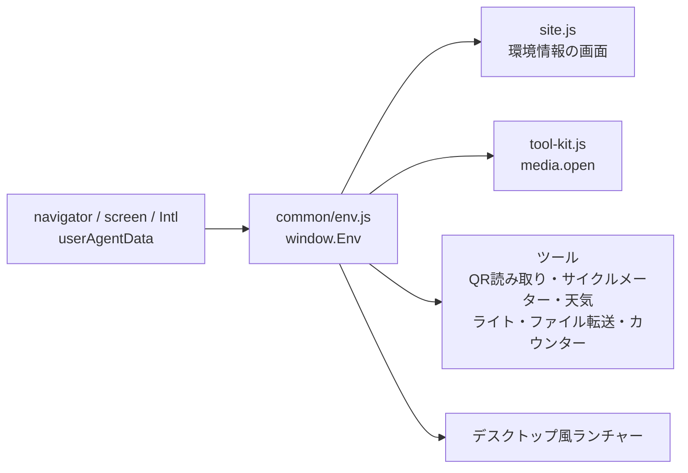

# 環境の判定 設計書

2026-11-07 作成・実装

## 概要

端末・ブラウザ・接続の状態を調べる処理を `common/env.js` の1ファイルにまとめ、`window.Env` として全ページで使えるようにします。ヘッダの「環境情報」の画面、ツールの https の確認、ファイル転送の端末名などが、同じ判定を使うようにします。端末の外には何も送りません。

## 課題と方針

| 課題(今の状態) | 方針 |
| --- | --- |
| OS・ブラウザの判定が `site.js` とファイル転送の `deviceName` の2か所にあり、ルールも違う(ファイル転送は「PC版サイト」表示の Android や iPad を見分けられない) | 判定は `env.js` だけに置き、両方がそれを使う |
| 環境情報の取得と画面の表示が `site.js` の中で混ざっている | 取得は `env.js`、画面は `site.js` に分ける |
| https でない時の確認を5ツール(QR読み取り・サイクルメーター・天気・ライト・ファイル転送)と `ToolKit.media.open` がそれぞれ書き、案内の文がばらばら | `Env.requireSecure(何に使うか)` を1つ用意し、案内とログの文を統一する |
| 起動ログに「https あり/なし」を出すツールと出さないツールがある(5ツールだけ出している) | 起動ログからは外す。https でない時は使う時点で `requireSecure` が警告を出し、環境情報の画面でも確認できるため |
| カウンターが `navigator.vibrate` を直接呼んでいる(iPhone などの扱いが `ToolKit.vibrate` と違う) | `ToolKit.vibrate` を使う。振動できるかは `Env.canVibrate()` で見る |
| 画面の倍率の上限(最大2倍)の計算が5か所にある | 描画の解像度の都合で、各ツールにあっても実害がないため今回は変えない |
| デスクトップ風ランチャーが `navigator.vibrate` を直接呼んでいる | ランチャーは `tool-kit.js` を読まないため、`Env.canVibrate()` で確認してから呼ぶ形にそろえる |

## 構成

読み込み順: `log.js` → `env.js` → `site.js` →(ツールのみ)`tool-kit.js` → 読み込み確認 → ツールのファイル。`env.js` はログ(`log.js`)を使います。

判定の中身(UA の読み取り)は DOM を使わない関数にして、Node でテストできるようにします(`module.exports` も出す)。

## 仕様

### 公開するもの(window.Env)

| 名前 | 返す物 | 例 |
| --- | --- | --- |
| `Env.os()` | OS 名 | `Android` / `iOS` / `iPadOS` / `Windows` / `macOS` / `ChromeOS` / `Linux` / `不明` |
| `Env.osVersion()` | OS の大きい版番号(取れた時だけ、Android の Chrome など) | `14` / `''` |
| `Env.browser()` | ブラウザ名 | `Chrome` / `Safari` / `Firefox` / `Edge` / `Samsung Internet` / `不明` |
| `Env.deviceName()` | 相手に見せる大まかな端末名 | `Android Chrome` / `iPhone Safari` / `iPad Safari` / `Windows Edge` |
| `Env.isSecure()` | https(か 127.0.0.1)で開いているか | `true` |
| `Env.requireSecure(何に)` | https なら `''`。違えば案内の文を返し、警告のログを出す | `'カメラの利用には https 接続が必要です'` |
| `Env.canVibrate()` | 振動の API があるか | `false`(iPhone) |
| `Env.isOnline()` / `Env.network()` | 通信の状態 / 回線の種類(取れた時だけ) | `true` / `4g` |
| `Env.canStore()` | localStorage に書けるか | `true` |
| `Env.language()` / `Env.timeZone()` | 言語 / タイムゾーン | `ja-JP` / `Asia/Tokyo` |
| `Env.screenSize()` / `Env.viewSize()` | 画面 / 表示領域の大きさ(縦×横) | `{height: 915, width: 412}` |
| `Env.pixelRatio()` | 画面の倍率 | `2.625` |
| `Env.orientation()` | 向き | `縦向き` / `横向き` |
| `Env.rows()` | 環境情報の画面に出す行(`[見出し, 値]` の配列、今と同じ12行) | — |
| `Env.ready` | OS の版番号など、後から分かる値がそろった時に終わる Promise | — |

### 判定のルール

- **OS:** `navigator.userAgentData.platform` が取れればそれを優先する(「PC版サイト」表示の Android Chrome でも Android と分かる)。取れない時は UA から。iPadOS 13 以降の Safari は UA が Mac と同じになるため、`Macintosh` かつ `navigator.maxTouchPoints > 1` を iPadOS とする。
- **ブラウザ:** UA の `EdgA?/` → Edge、`SamsungBrowser/` → Samsung Internet、`Firefox|FxiOS` → Firefox、`Chrome/|CriOS` → Chrome、`Safari/` → Safari の順に見る(Chrome 系の UA は Safari の文字も含むため、この順にする)。
- **端末名:** OS が iOS なら `iPhone`、iPadOS なら `iPad`、ほかは OS 名。それにブラウザ名を続ける。個人を特定できる情報(機種名など)は使わない。

### メッセージ

文言は `env.js` の先頭に `MSG` として埋め字で並べ、`log.format` で埋めます。

| キー | 文言 |
| --- | --- |
| needSecure | `{用途}の利用には https 接続が必要です` |
| needSecureLog | `https 接続でないため、{用途}を使えませんでした`(警告) |

天気のように代わりの手段がある時は、ツールが返った文の後ろに案内を足します(例: 「地名で検索してください」)。

### 置き換える所

| 場所 | 今 | 変更後 |
| --- | --- | --- |
| `site.js` 環境情報 | 自分で OS・ブラウザを判定し行を作る | `Env.rows()` を表示し、`Env.ready` の後にもう一度表示する。`Env` が無い時はボタンを出さない |
| `tool-kit.js` `media.open` | 自分で `isSecureContext` を見る | `Env.requireSecure(label)` |
| QR読み取り・サイクルメーター・天気・ライト・ファイル転送 | 自分で確認し独自の文 | `Env.requireSecure('カメラ')` など |
| 水平器・サイクルメーター・騒音計・方位磁針・ライトの起動ログ | `(https あり/なし)` を含む | 外す |
| ファイル転送 | core の `deviceName(ua)` | `Env.deviceName()`。core から `deviceName` を削除 |
| カウンター | `navigator.vibrate(40)` | `ToolKit.vibrate(40)`、可否は `Env.canVibrate()` |
| デスクトップ風ランチャー | `navigator.vibrate` の有無を直接確認 | `Env.canVibrate()` で確認 |

## 処理の流れ

1. `env.js` を読むと、UA と `userAgentData.platform` から OS・ブラウザを決めて `window.Env` を作る。
2. 対応するブラウザでは `userAgentData.getHighEntropyValues(['platformVersion'])` で OS の版番号を取りに行き、終わったら `Env.ready` が終わる(取れなくても終わる)。
3. 環境情報の画面は開くたびに `Env.rows()` を読み直す(向き・通信などが変わるため)。
4. ツールは機能を使う直前に `Env.requireSecure()` を呼び、空でなければその文を画面に出して止まる。

## 制限事項

- UA の書き換えや、ブラウザの「PC版サイト」表示で、判定が実際と違うことがある(Safari・Firefox には `userAgentData` が無い)。
- OS の版番号は Chromium 系のブラウザでしか取れない。
- `env.js` が読めないと `Env` を使うツールは止まる。`log.js` などと同じ場所から配信するため、片方だけ読めないことはほぼ無いが、その時も HTML の読み込み確認は `log.js`・`tool-kit.js` が読めた物として案内を出さない([page-base.md](./page-base.md))。

## 確認

- UA の判定を Node でテストした(Android Chrome、PC版サイト表示の Android、iPhone の Safari と Chrome、iPadOS の Safari、タッチの無い Mac の Safari、Windows Edge、Samsung Internet、Android Firefox、ChromeOS、UA が空の時)。
- ブラウザ(Playwright)で、環境情報の画面が12行を出すこと(ツールと一覧ページ)、https でない時に ライト・天気・サイクルメーター・QR読み取り・ファイル転送・`ToolKit.media.open` が統一した文を出し、警告が1行出ることを確かめた。カウンターの振動が `ToolKit.vibrate` を通ることも確かめた。
- 実機で確かめること: Android の「PC版サイト」表示と iPad の Safari での OS の判定、Android の Chrome で OS の版番号が出ること。
