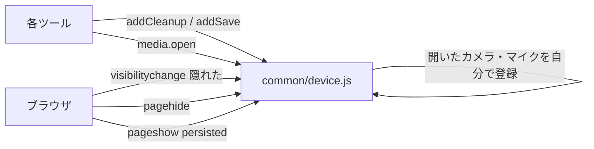
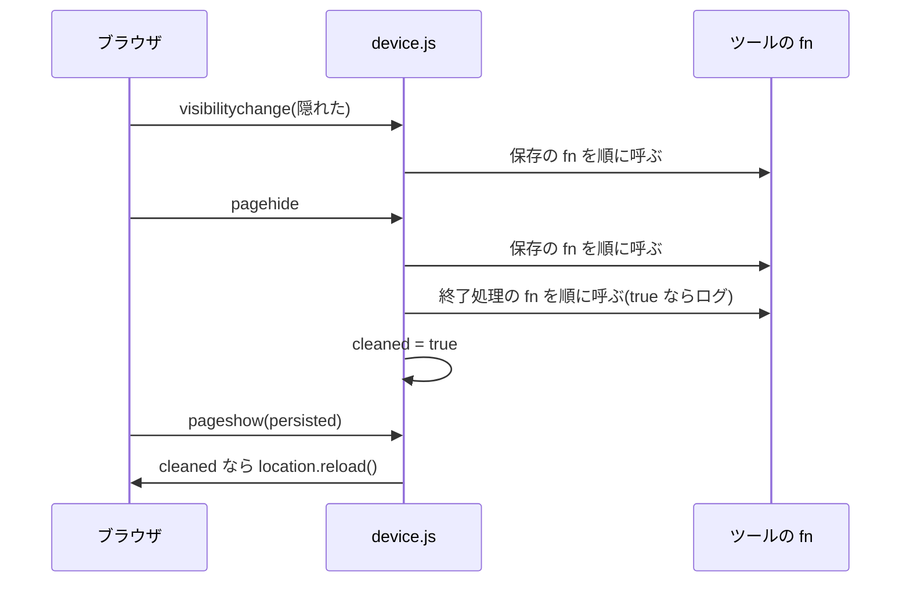

# ページを離れる時の終了処理 設計書

状態: 段 2 まで実装。作成 2026-11-08、更新 2026-11-08。

## 1. 概要

ツールを閉じた時、別のページへ移った時、戻るボタンで戻った時に、カメラ・マイク・読み上げ・位置の監視などを必ず止めるための共通の仕組みです。今は各ツールが `pagehide` などを自分で書いていて、書き方も漏れ方もばらばらです(2.1 の課題)。

- うまくいったと言える目安: どのツールでも、ページを離れた後にカメラのランプが点いたまま・読み上げが続いたまま、にならない。書いたメモが、ブラウザを閉じても消えない。
- 前提: https。スマホの Safari と Chrome(Android)を主に考える。
- やらないこと:
  - ブラウザの「このページを離れますか?」の確認(`beforeunload` の確認画面)。スマホでは出ないことが多く、戻るボタンの速い復元(bfcache)も効かなくなるため。
  - 落ちた時・OS がアプリを止めた時の後始末。この時は JavaScript が動かない。カメラなどは OS が放すので、困るのはデータの保存だけで、それは「画面が隠れた時に保存する」で守る。

## 2. 基本設計

### 2.1 要件と課題

要件:

| 番号 | 要件(受け入れの条件) |
| --- | --- |
| R-01 | 別のページへ移った時・タブを閉じた時・ランチャーの中で閉じた時、登録した終了処理を1回ずつ呼ぶ |
| R-02 | 終了処理の1つが失敗しても、残りの終了処理は呼ぶ(失敗はエラーのログ) |
| R-03 | `ToolKit.media.open` で開いたカメラ・マイクは、ツールが何も書かなくても止まる(今と同じ) |
| R-04 | 画面が隠れた時(アプリの切り替え・画面を消した時)、登録した保存の処理を呼ぶ |
| R-05 | 戻るボタンで、終了処理を済ませたページが復元された時、読み込み直して最初の画面から始める |
| R-06 | QR 読み取りは、読めた時・停止した時・ページを離れた時にカメラが止まる |
| R-07 | 懐中電灯は、ライトの無いカメラを試した後、開いたカメラを残さない。ページを離れた時はライトが消える |
| R-08 | メモ帳は、入力してすぐ画面が隠れた時も、書いた内容を保存する |

課題と方針:

| 課題 | 方針 |
| --- | --- |
| 各ツールが `pagehide` を自分で書いている(13ツール)。漏れても気づけない | `ToolKit` に登録の関数を1つ作り、ツールはそこに渡すだけにする。次にそのツールに手を入れる時に移す |
| QR 読み取りの停止が効いていない。ZXing 0.21.3 の `decodeFromConstraints` は何も返さないのに、返り値の `controls.stop()` で止めている | カメラは `ToolKit.media.open` で開き、ZXing には読み取り(`decodeFromStream`)だけをさせる。止める時は `codeReader.reset()` |
| QR 読み取りが `beforeunload` も使っている | `pagehide` だけにする(`beforeunload` は bfcache を効かなくする) |
| メモ帳は `pagehide` でだけ保存している。スマホでアプリを上に払って閉じると、`pagehide` が来ないことがある | 保存は「画面が隠れた時」に行う(R-04) |
| 懐中電灯が `getUserMedia` を直接呼び、自分で止めている | `ToolKit.media.open` に移す(R-03 で止まる) |

採らなかった案:

| 案 | 理由 |
| --- | --- |
| `unload` を使う | 非推奨。Chrome では使えなくなっていく。`pagehide` で足りる |
| `beforeunload` で止める | スマホで来ないことがあり、bfcache も効かなくなる |
| 各ツールに `pagehide` を書く今のまま | 漏れが見つからない。今回の QR のような不具合が残る |
| 名前を `onLeave` / `onHide` にする | 短いが、動詞から始める決まりに合わない(決定 2026-11-08) |
| 画面が隠れた時にカメラ・マイクも止める | ボイスメモで画面を消すと録音が止まる。スマホのブラウザは隠れたページのカメラをもともと止めることが多い(決定 2026-11-08) |
| 戻った時に、各ツールが続きから再開する | ツールごとに再開を書いて試す手間が増える。読み込み直すほうが確実(決定 2026-11-08) |
| 13ツールをまとめて移す | 変える所と実機の確認が多い。段に分け、ほかは手を入れる時に移す(決定 2026-11-08) |

### 2.2 外部仕様

使う人から見える事:

| 場面 | 見える事 |
| --- | --- |
| ツールから一覧へ戻る・別のページへ移る・タブを閉じる | カメラ・マイクのランプが消える。読み上げ・音が止まる |
| アプリを切り替える・画面を消す | 書いた物が保存される。カメラ・録音は止めない(止めたいツールは自分で止める) |
| 戻るボタンでツールに戻る | 終了処理を済ませたページは読み込み直され、最初の画面から始まる |

ログに出す事:

| 時 | ログ |
| --- | --- |
| 終了処理で何かを止めた時 | `<名前>を停止しました(ページを離れたため)`(今のカメラ・マイクと同じ形) |
| 終了処理が失敗した時 | `<名前>の終了処理でエラーが発生しました`(エラー) |

ページを離れる時のログは、そのページのデバッグ画面と一緒に消えます。見えるのは、ランチャーの中で閉じた時など、ログが残る場面だけです。

### 2.4 処理方式

- 使うブラウザの出来事:
  - `pagehide`: 別のページへ移る・閉じる・bfcache に入る・iframe が外される、のすべてで来る。終了処理はこれで呼ぶ。
  - `visibilitychange`(`document.hidden` が真): スマホで最後に確実に来る出来事。保存はこれで呼ぶ。
  - `pageshow`(`event.persisted` が真): bfcache から戻った時。R-05 はこれで扱う。
- 置き場所: `common/device.js` の中(`ToolKit` に足す)。カメラ・マイクの自動停止も、同じ仕組みの上に載せ直す。
- 失敗の扱い: 終了処理は1つずつ `try` で包み、失敗してもほかを呼ぶ(R-02)。
- 名前: `ToolKit.addCleanup`(終了処理)と `ToolKit.addSave`(保存)。動詞から始める決まりに合わせた。

## 3. 詳細設計

### 3.1 プログラム構成

| ファイル | 変える事 | 行数の目安 |
| --- | --- | --- |
| `common/device.js` | 終了処理と保存の登録を足す。カメラ・マイクの自動停止を、その上に載せ直す | +40 |
| `tools/qr-reader/qr-reader.js` | カメラを `ToolKit.media.open` で開き、ZXing は `decodeFromStream` だけにする。止めるのは `codeReader.reset()` と `ToolKit.media.stop`。`pagehide` と `beforeunload` の自前の登録を消す | ±30 |
| `tests/stubs/fake-zxing.js` | 新規。ZXing の偽物(`BrowserQRCodeReader` の `decodeFromStream` と `reset`) | 30 |
| `tests/scenarios/page-exit.js` | 新規。T-01〜T-06 | 120 |
| `docs/design/device.md`・`docs/common.md` | 公開する関数を足す | 数行 |

段 2 で `tools/flashlight`(`ToolKit.media.open` に移す)と `tools/notepad`(`addSave` に移す)を直します。

### 3.2 部品の仕様

| 関数 | 引数 | すること |
| --- | --- | --- |
| `ToolKit.addCleanup(fn, name)` | `fn`: 止める処理。`name`: ログに出す名前(「読み上げ」など) | `pagehide` の時に `fn()` を呼ぶ。`fn` が `true` を返したら `<name>を停止しました(ページを離れたため)` をログに出す。止める物が無い時は `false` か何も返さない。何度呼ばれても困らないように書く |
| `ToolKit.addSave(fn)` | `fn`: 保存の処理 | 画面が隠れた時と `pagehide` の時に `fn()` を呼ぶ。ログは出さない(何度も来るため)。何度呼ばれても困らないように書く |

- どちらも、登録を外す関数は作りません。止める物が無い時に何もしないように `fn` を書けば足りるためです。
- `fn` が例外を投げた時は `<name>の終了処理でエラーが発生しました`(保存は `保存でエラーが発生しました`)をエラーのログに出し、次の `fn` を呼びます。
- `ToolKit.media.open` は、開いた stream を自分で `addCleanup` に登録します(名前は「カメラ」「マイク」)。ツールは何も書きません。

### 3.3 データ設計

device.js の中に持つ物です。外には出しません。

| 名前 | 中身 |
| --- | --- |
| `cleanups` | `{ fn, name }` の配列。登録した順に呼ぶ |
| `saves` | `fn` の配列 |
| `cleaned` | `pagehide` で終了処理を呼んだら `true`。`pageshow` で読み込み直すかを決める |

### 3.4 処理の流れ

- `pagehide` で `cleaned` を立てるのは、終了処理が1つ以上登録されている時だけです。何も使っていないページ(電卓など)は、戻るボタンでそのまま復元されます。
- QR 読み取りの流れ: 読み取り開始 → `ToolKit.media.open` → `codeReader.decodeFromStream(stream, video, 読めた時)`。読めた時と停止の時は `codeReader.reset()`(読み取りの繰り返しを止める)と `ToolKit.media.stop(stream)`。ページを離れた時は、`open` が登録した終了処理でカメラが止まり、繰り返しは video が止まって終わります。

## 4. 制限事項と試験

### 4.1 制限事項

- 「必ず」にできない場面があります。ブラウザが落ちた時、OS がアプリを止めた時、アプリを上に払って閉じた時の一部です。この時は JavaScript が動かないので、終了処理は呼ばれません。カメラ・マイク・位置は OS が放します。データは、画面が隠れた時の保存(R-04)で守ります。
- 実機での出来事の来方(特に iPhone の Safari で、払って閉じた時)は要確認です。

### 4.2 試験

| 番号 | 要件 | 方法 |
| --- | --- | --- |
| T-01 | R-01 | 画面の試験: `pagehide` を起こし、登録した処理が1回ずつ呼ばれる |
| T-02 | R-02 | 画面の試験: 1つ目が例外を投げても、2つ目が呼ばれ、エラーのログが出る |
| T-03 | R-03 | 画面の試験(今の自動停止の試験を残す) |
| T-04 | R-04 | 画面の試験: `visibilitychange` を起こし、保存の処理が呼ばれる |
| T-05 | R-05 | 画面の試験: `pageshow`(persisted)を起こす |
| T-06 | R-06 | 画面の試験: ZXing のスタブを作り、読めた時・停止・`pagehide` でトラックが止まる |
| T-07 | R-01, R-06 | 実機: QR 読み取りで読んだ後、カメラのランプが消える。一覧へ戻った後も消えている |
| T-08 | R-07 | 画面の試験: 偽のカメラ(ライトが無い)で点灯を押し、開いたカメラが全部止まっている。画面に「対応していません」が出る |
| T-09 | R-08 | 画面の試験: 新しいメモに書いてすぐ `visibilitychange` を起こし、localStorage に入っている |
| T-10 | R-07, R-08 | 実機: 懐中電灯を点けて一覧へ戻るとライトが消える。メモ帳に書いてすぐアプリを払って閉じ、開き直すと残っている |

## 5. 決めてほしいこと

- Q1 関数の名前: 決定(2026-11-08)。`addCleanup` / `addSave`。
- Q2 画面が隠れた時にカメラ・マイクも止めるか: 決定(2026-11-08)。止めない。
- Q3 戻るボタンで戻った時: 決定(2026-11-08)。読み込み直す。
- Q4 進め方: 決定(2026-11-08)。段 1 は仕組みと QR、段 2 は懐中電灯とメモ帳。ほかは手を入れる時に移す。

## 6. 実装の記録

### 段 1 / 2026-11-08

やった事:
- `common/device.js` に `ToolKit.addCleanup` / `ToolKit.addSave` と、`pagehide`・`visibilitychange`・`pageshow` の扱いを足した。カメラ・マイクの自動停止を、開くたびに `addCleanup` へ登録する形に載せ直した。
- `tools/qr-reader/qr-reader.js`: カメラを `ToolKit.media.open` で開き、ZXing は `decodeFromStream` だけにした。止める時は `codeReader.reset()` と `ToolKit.media.stop`。自前の `pagehide` と `beforeunload` を消した。https とブラウザの対応の確認は `ToolKit.media.open` に任せた。
- `tests/stubs/fake-zxing.js` と `tests/scenarios/page-exit.js` を足した。

確かめた事:
- `node tests/scenarios/page-exit.js`: T-01〜T-06 が合格。
- 古い QR 読み取りに、本物の 0.21.3 と同じく何も返さない `decodeFromConstraints` を偽物に足して流すと、T-06 が「読めた後もカメラが点いている」「ページを離れた後もカメラが点いている」で落ちた。不具合が本当にあった事を確かめた。
- `node tests/core.js`、`node tests/smoke.js all` が合格。

残った事:
- T-07(実機): QR 読み取りで読んだ後、カメラのランプが消えるか。本物の ZXing と、戻るボタンで読み込み直す動きも実機で要確認。
- 段 2: 懐中電灯とメモ帳。

AI が決めた事:
- `fn` が `true` を返した時だけ停止のログを出す。止める物が無い時にログが出ないようにするため(`ToolKit.media.stop` と同じ約束)。
- QR 読み取りは、読めた時に `reset()` に加えて `ToolKit.media.stop` も呼ぶ。本物の `reset()` もトラックを止めるが、止めるのを ZXing だけに頼らないため。

### 段 2 / 2026-11-08

やった事:
- `tools/flashlight/flashlight.js`: `getUserMedia` を直接呼ぶのをやめ、`ToolKit.media.open` / `ToolKit.media.stop` にした。自前の `pagehide` を消した(ページを離れる時は `open` が登録した終了処理で止まる)。
- `tools/notepad/notepad.js`: `pagehide` の保存を `ToolKit.addSave(saveNow)` にした。あわせて、決まりに合わない略 `fmtDate` を `formatDate` に直した。
- `tests/scenarios/page-exit.js` に T-08 と T-09 を足した。

確かめた事:
- `node tests/scenarios/page-exit.js`: T-01〜T-06、T-08、T-09 が合格。
- 古いメモ帳で流すと、T-09 が「画面が隠れた時に保存されていない」で落ちた(入力から 0.4 秒たつ前に隠れると、保存されていなかった)。

残った事:
- T-07・T-10(実機)。
- ほかのツールの `pagehide`(読み上げ・位置・URL の解放など)は、手を入れる時に `addCleanup` へ移す。

設計と違った事:
- 懐中電灯のページを離れる時のログが「ページを離れるためライトを消灯しました」から「カメラを停止しました(ページを離れたため)」に変わった。ほかのカメラのツールと同じ形にそろえた。

AI が決めた事:
- 懐中電灯の、ライトを点ける・消す処理(`applyConstraints`)は、今回は変えていない。`ToolKit.media.torch` に移すと消灯のログが二重になるため、やることの表を入れる時にまとめて直す。

